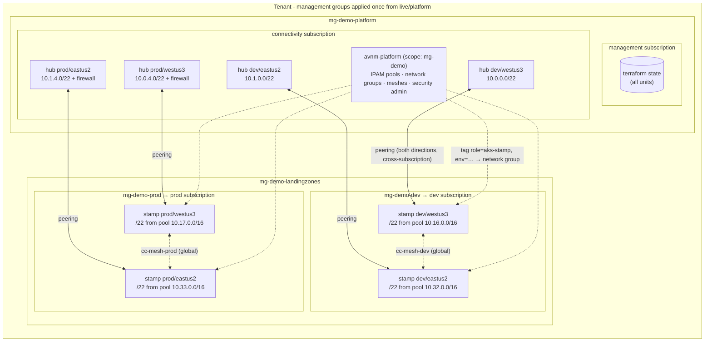
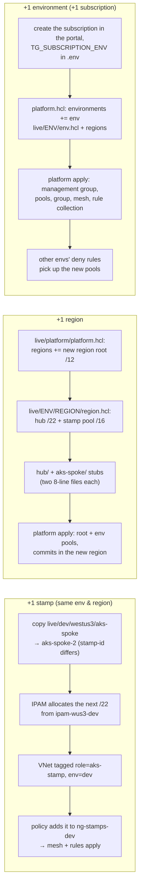

# azure-aks-platform

A public example of a **DRY, multi-environment, multi-region Azure AKS
platform** built with Terraform + Terragrunt on a **hub-and-spoke** network
topology - composed from [Azure Verified Modules](https://aka.ms/avm) and
tuned so the development configuration costs **~$75-100/month**, not
$1,700+.

Inspired by
[`Azure/terraform-azurerm-avm-ptn-aks-enterprise`](https://github.com/Azure/terraform-azurerm-avm-ptn-aks-enterprise),
but not consuming it: at v0.1.0 that pattern hardcodes an Azure Firewall
Standard, ACR Premium, a private cluster with UDR, and D16ds_v5 nodes, and it
can't join an existing hub-spoke topology (it creates its own VNet and
doesn't export its ID). This repo composes the same AVM building blocks
directly and puts **every expensive feature behind a per-environment
toggle, defaulting to off**. Details in
[docs/architecture.md](docs/architecture.md).

## What you get

- **2 environments × 2 regions** (dev/prod × westus3/eastus2), each a
  hub-spoke pair with globally non-overlapping addressing
  ([docs/ipam.md](docs/ipam.md))
- **Landing-zone layout**: one subscription per role (management,
  connectivity, dev, prod) under a small management-group hierarchy, all
  placed by `root.hcl` from env vars - and a single-subscription mode that
  needs nothing extra ([docs/subscriptions.md](docs/subscriptions.md))
- **Short leaf configs**: all logic lives in `root.hcl`, `platform.hcl`,
  `env.hcl`, `region.hcl`, and the `_envcommon` files - adding a region is
  one folder and two CIDRs, adding a stamp is one folder
- **Cost toggles** for firewall, ACR SKU, Log Analytics, managed
  Prometheus, container insights, Defender, Azure Policy, cluster tier,
  private cluster ([docs/costs.md](docs/costs.md))
- **Stamp networking, two ways**: every AKS spoke is a uniform /22 "stamp"
  with a fixed subnet layout. Turn on `enable_avnm` and one tenant-wide
  Azure Virtual Network Manager hands each stamp its /22 from a region →
  environment IPAM pool hierarchy, puts it in a tag-driven network group,
  meshes every stamp of the environment across regions and subscriptions
  (direct cluster-to-cluster, no hub hop) and applies security admin
  guardrails ([docs/network-platform.md](docs/network-platform.md))
- **Public DNS** (`live/platform/dns`, optional): one `azure.<your domain>`
  zone with a delegated child zone per environment that each stamp's
  external-dns publishes into ([docs/dns.md](docs/dns.md))
- **Identity building blocks**: one workload identity per component per
  stamp (cert-manager, external-dns, External Secrets), a Key Vault per
  environment, GitHub OIDC push identities, and a zone-scoped service
  principal for clusters that run outside Azure
  ([docs/identity.md](docs/identity.md))
- **Local clusters as an environment**: a laptop cluster (e.g. Rancher
  Desktop / k3s) gets a public DNS zone, a Key Vault + External Secrets
  principal and a Basic ACR - and nothing else (`modules/local-cluster`)
- **Pipelines**: `ci` (offline validation, tflint, trivy, terraform-docs
  check and secret scan on every push), `plan` (OIDC plan of every layer on
  every PR), `deploy` (manual, main-only, confirm-to-apply) and
  `aks-schedule` (optional overnight stop of dev clusters) -
  [docs/github-oidc-setup.md](docs/github-oidc-setup.md)
- **Module sources pinned to commit SHAs**: every AVM module is consumed as
  `git::...?ref=<40-char sha>` with the tag in a trailing comment
- **Zero secrets**: `az login` / GitHub OIDC auth, Entra RBAC state access
  (no storage keys), managed identities everywhere, gitleaks in CI and
  pre-commit
- **Offline-validatable**: the whole dependency graph inits, validates, and
  plans with mocked cross-stack outputs and a local-backend fallback - CI
  needs no Azure at all for the `ci` workflow

## Topology

One tenant, four subscriptions by role, two environments, two regions. The
tenant-level pieces are applied once from `live/platform`; each
environment is applied from `live/<env>`. Hubs live in the connectivity
subscription; every AKS *stamp* (one cluster + one /22 VNet) lives in its
environment's subscription and is allocated, grouped, meshed and guarded by
the one Azure Virtual Network Manager at the top management group.



Each stamp VNet is cut the same way (system /25, ilb /27, user /24, pe /24;
[docs/ipam.md](docs/ipam.md)). Traffic between stamps of one environment
rides the mesh directly on node IPs - no hub hop, no NAT - and the calling
stamp's node subnets are the caller identity for in-cluster policy.
Environments never share a mesh, and security admin rules deny every other
environment's pools before any NSG is consulted.

### N+1: adding a stamp, a region, an environment

Nothing above is wired by hand. Each kind of growth is a folder plus a few
lines, and the platform reacts through data: IPAM hands out the next /22,
the tag-driven policy adds the VNet to its group, the committed mesh and
rules apply to the new member automatically.



The state of each stamp is independent: adding or destroying one never
touches the hub, the platform or another stamp (membership is by tag, both
peering directions are created by the stamp). Limits that matter at scale
(addresses per connected group, VNets per mesh) are listed in
[docs/network-platform.md](docs/network-platform.md).

## Layout

```
modules/
├── management-groups/  mg-<prefix> → platform / landingzones → <env>; subscription placement
├── platform-network/   one AVNM at the top MG: IPAM pool hierarchy, network groups, meshes, security admin
├── public-dns/         azure.<org> public zone + one delegated child zone per environment
├── public-dns-principals/  zone-scoped service principal per environment outside Azure (local clusters)
├── service-principal/  Entra app + SP + Terraform-rotated client secret (tier-4 building block)
├── workload-identity/  managed identity + federated credential + roles for one service account (tier-1 building block)
├── github-actions-identity/  managed identity + federated credentials + roles for one GitHub repo's workflows (tier-2 building block)
├── key-vault/          an environment's RBAC Key Vault (managed / generated / operator-placeholder secrets)
├── local-cluster/      rg + key-vault + External Secrets principal (+ Basic ACR, push identities, pull token) for an environment outside Azure
├── hub/                wraps avm-ptn-hubnetworking (firewall optional)
└── aks-spoke/          stamp vnet (/22, IPAM or static) + hub peering + AKS + optional ACR/LAW
live/
├── root.hcl                     backend + provider generation; subscription placement per unit path
├── _envcommon/                  shared unit config + dependency wiring (one file per unit type)
├── platform/                    applied once per tenant
│   ├── platform.hcl             environments, subscription roles (env vars), regional root pools
│   ├── management-groups/
│   ├── dns/                     public zones; external dependency of every stamp
│   ├── dns-principals/          DNS credentials for external environments (docs/identity.md)
│   └── network/                 external dependency of every stamp
├── dev/                         cheapest-possible settings, opt-in to the mesh
│   ├── env.hcl
│   ├── keyvault/                kv-demo-dev: the environment's secret store (External Secrets reads it)
│   ├── local/local-cluster/  Key Vault + ESO principal + ACR for the local Rancher Desktop cluster
│   ├── westus3/{region.hcl, hub/, aks-spoke/}
│   └── eastus2/{region.hcl, hub/, aks-spoke/}
└── prod/                        everything on (plan-only in CI)
    └── ...same shape
bootstrap/        state storage, provider registration, OIDC identities, tenant access (az CLI)
catalog/          which stamps may call which -> generated Cilium caller policies
scripts/          setup-dev, install-tools (pinned), lint (tflint/trivy/terraform-docs), aks-power
docs/             architecture, subscriptions, IPAM, network platform, DNS, identity, costs, OIDC/CI setup
.ai/              live state (ACTIVE_SESSION.md), plans, ADRs, backlog, test evidence
```

## Quick start

Prereqs: [terraform](https://developer.hashicorp.com/terraform/install) and
[terragrunt](https://terragrunt.gruntwork.io/) (versions in
`.tool-versions`), the [az CLI](https://learn.microsoft.com/cli/azure/), and
an Azure subscription - or several, one per role, for the landing-zone
layout ([docs/subscriptions.md](docs/subscriptions.md)).

```bash
git clone git@github.com:travismoran/Azure-Hub-and-Spoke-Multi-Region-Platform-Example.git
cd Azure-Hub-and-Spoke-Multi-Region-Platform-Example

# 0. One-time: install pinned gitleaks + activate secret-scan git hooks
./scripts/setup-dev.sh

# 1. Configure your environment (nothing real is ever committed)
cp .env.example .env    # edit: subscription(s), tenant, state names, your IP
source .env
az login

# 2. One-time: create the remote state storage account
./bootstrap/bootstrap-state.sh

# 3. One-time: register resource providers in every subscription
#    (the provider config sets resource_provider_registrations = "none")
./bootstrap/register-providers.sh

# 4. One-time, multi-subscription layout only: tenant-root access for the
#    management groups (docs/subscriptions.md), then the tenant-level platform
cd live/platform && terragrunt run --all -- apply     # management groups → network platform + public DNS
#    if you enabled public DNS: delegate azure.<your domain> at your registrar (docs/dns.md)

# 5. Plan and apply dev (hubs → spokes via the dependency graph)
cd ../dev
terragrunt run --all -- plan
terragrunt run --all -- apply
#    One region only: cd live/dev/westus3 && terragrunt run --all -- apply

# 6. Connect
az aks get-credentials -g rg-aks-dev-wus3 -n aks-demo-dev-wus3
kubectl get nodes
```

Tear down with `terragrunt run --all -- destroy` in the same directory.
(`live/platform/network` is an external dependency of every spoke; its
outputs are read from state, so apply the platform first. Validation works
from anywhere because the dependency is mocked.)

No subscription yet? Everything still validates offline:

```bash
cd live && terragrunt run --all -- validate
```

## Feature toggles

Set per environment in `live/<env>/env.hcl`:

| Toggle | dev | prod | Cost impact |
|---|---|---|---|
| `aks_sku_tier` | `Free` | `Standard` | $73/mo/cluster |
| `enable_firewall` | `false`* | `true` | $300-900+/mo |
| `enable_avnm` | `false`** | `true` | ~$73/mo per stamp VNet + IPAM per IP (the AVNM itself is free) |
| `private_cluster_enabled` | `false` | `true` | needs jumpbox/Bastion to reach |
| `acr_sku` | `Basic` | `Premium` | $5 vs $50/mo |
| `enable_log_analytics` | `false` | `true` | ~$2.76/GB ingested |
| `enable_container_insights` | `false` | `true` | ingestion volume |
| `enable_managed_prometheus` | `false` | `true` | workspace free, metrics per sample |
| `enable_defender` | `false` | `true` | ~$7/vCPU/mo |
| `enable_azure_policy` | `false` | `true` | free |
| `enable_telemetry` (AVM) | `false` | `false` | phone-home, disabled |
| system pool | 1× D2s_v6 | 3× D4ds_v5 zoned | ~10× |
| user pools | Spot, scales from 0 | on-demand zoned | ~5-10× |
| `aks_outbound_type` | `loadBalancer` | `loadBalancer`* | `userDefinedRouting` sends egress through the hub firewall |
| `enable_avnm_routing` | `false` | `false`* | AVNM pushes the default route instead of per-stamp UDRs |
| `enable_private_dns` / `enable_external_dns_identity` | `false` | `false` | central `svc.<env>.platform.internal` zone, ~$0.50/mo |
| `enable_api_server_vnet_integration` | `false` | `false` | free |
| `enable_dns_resolver` | `false` | `false` | ~$180/mo per hub |
| `enable_bastion` (`bastion_sku`) | `false` | `false` | ~$140/mo Basic; Developer free |
| `enable_extra_stamps` | `false` | `false` | includes `aks-spoke-2`, ... in `run --all` |

\* prod's intended end state is `userDefinedRouting` + `enable_avnm_routing`;
both stay off until verified in dev with a firewall (ADR-016).

\* flip to `true` to enable the cross-region hub-to-hub transit path
(Firewall Basic per hub, UDRs, transit rules - all activate automatically;
see [docs/architecture.md](docs/architecture.md)). Verified end-to-end;
evidence in `.ai/test-results/`.

\** flip to `true` to opt the environment into the tenant-wide AVNM
(`live/platform/network`): IPAM-allocated stamp /22s, one global mesh per
environment (direct cross-region cluster-to-cluster with no firewall in the
path) and security admin guardrails; see
[docs/network-platform.md](docs/network-platform.md). Verified live
2026-11-02 across subscriptions; evidence in `.ai/test-results/`.

## CI

- **`ci.yml`** - runs on every push/PR with no configuration: gitleaks secret
  scan, `terraform fmt`, `terragrunt hcl fmt`/`validate`, module validation,
  and a full offline `run --all validate` of the live tree.
- **`plan.yml`** - optional: `terragrunt run --all plan` for dev against your
  real subscription(s) via OIDC federated credentials
  ([docs/github-oidc-setup.md](docs/github-oidc-setup.md)). Skips itself if
  the repo variables aren't set. **There is deliberately no apply job.**

## Deliberate omissions

- **No secrets, anywhere** - and no values that even look like them. Layered
  enforcement: `scripts/setup-dev.sh` installs pinned gitleaks and activates
  git hooks (pre-commit: file types + keyword patterns + gitleaks staged;
  pre-push: worktree + full history), with the same checks in
  `.pre-commit-config.yaml` and CI as backstops.
- **No applies in CI** - this is an example; applying costs money and should
  be a human decision.
- **No Terragrunt stacks** - the experimental `terragrunt.stack.hcl` feature
  could shrink the leaf files further, but classic includes are stable and
  universally understood.
- **No subscription vending** - subscriptions are created in the portal and
  referenced by ID; Terraform-created subscriptions need an EA/MCA/MPA
  billing account, which a personal Pay-As-You-Go account is not
  ([docs/subscriptions.md](docs/subscriptions.md)).
- **Forks must change `TG_NAME_PREFIX`** (or `name_prefix` default) - ACR
  and storage account names are globally unique across Azure, and
  management group IDs are unique per tenant.

## License

MIT - see [LICENSE](LICENSE).
