# Architecture

## Topology

Each environment × region pair is an independent hub-and-spoke deployment:
a hub VNet (optionally hosting an Azure Firewall) peered with a spoke VNet
that contains the AKS cluster, its optional ACR, and a subnet reserved for
private endpoints.

```mermaid
flowchart TB
    subgraph dev-westus3["dev / westus3"]
        hub1["hub vnet 10.10.0.0/22<br/>(firewall: off)"]
        spoke1["spoke vnet 10.11.0.0/16<br/>AKS Free tier + ACR Basic"]
        hub1 <-- peering --> spoke1
    end
    subgraph dev-eastus2["dev / eastus2"]
        hub2["hub vnet 10.20.0.0/22<br/>(firewall: off)"]
        spoke2["spoke vnet 10.21.0.0/16<br/>AKS Free tier + ACR Basic"]
        hub2 <-- peering --> spoke2
    end
    subgraph prod-westus3["prod / westus3"]
        hub3["hub vnet 10.110.0.0/22<br/>Azure Firewall Standard"]
        spoke3["spoke vnet 10.111.0.0/16<br/>AKS Standard, private, LAW, Defender"]
        hub3 <-- peering --> spoke3
    end
    subgraph prod-eastus2["prod / eastus2"]
        hub4["hub vnet 10.120.0.0/22<br/>Azure Firewall Standard"]
        spoke4["spoke vnet 10.121.0.0/16<br/>AKS Standard, private, LAW, Defender"]
        hub4 <-- peering --> spoke4
    end
```



All address ranges are globally non-overlapping (see [ipam.md](ipam.md)), so
hubs can later be peered to each other or to on-prem without renumbering.

## Why not `Azure/terraform-azurerm-avm-ptn-aks-enterprise` directly?

This repo was inspired by that pattern module, but does not consume it. At
v0.1.0 (its only release) the module:

- hardcodes an **Azure Firewall Standard** (~$912/mo), **ACR Premium**, a
  **private cluster with user-defined routing**, and a
  **Standard_D16ds_v5** default node pool (~$500+/mo);
- creates its **own VNet** with no input for an existing subnet;
- exports only the AKS resource — **no VNet ID output** — so a true
  hub-and-spoke peering topology cannot be built around it.

Instead, the same building blocks it uses internally — Azure Verified
Modules — are composed directly, with every expensive feature behind a
toggle:

| Layer | Module | Version |
|---|---|---|
| Hub VNet (+ optional firewall) | `Azure/avm-ptn-hubnetworking/azurerm` | 0.13.2 |
| Spoke VNet + peering | `Azure/avm-res-network-virtualnetwork/azurerm` | 0.19.0 |
| AKS | `Azure/avm-res-containerservice-managedcluster/azurerm` | 0.6.7 |
| ACR | `Azure/avm-res-containerregistry-registry/azurerm` | 0.5.1 |
| Log Analytics | `Azure/avm-res-operationalinsights-workspace/azurerm` | 0.5.1 |

## Terragrunt layering (how DRY works here)

```
live/
├── root.hcl            backend + provider generation (env-var driven)
├── _envcommon/
│   ├── hub.hcl         module source, inputs assembled from env+region
│   └── aks-spoke.hcl   ... plus dependency "hub" with mock_outputs
├── <env>/env.hcl       all feature toggles and sizing for the environment
└── <env>/<region>/
    ├── region.hcl      location + CIDR assignments
    └── <unit>/terragrunt.hcl   two include blocks, nothing else
```

- **Leaf files are identical 8-line stubs.** Adding a region = one folder,
  one `region.hcl` with four CIDRs, two stub files.
- `_envcommon/*.hcl` reads the nearest `env.hcl`/`region.hcl` itself via
  `read_terragrunt_config(find_in_parent_folders(...))`, so leaves carry no
  wiring.
- The spoke declares `dependency "hub"` with `mock_outputs`, so
  `init`/`validate`/`plan` work before the hub exists (fresh clones, CI).
- When `TG_STATE_*` env vars are unset, `root.hcl` falls back from the
  `azurerm` backend to a throwaway local backend, letting the entire graph
  validate offline with zero Azure access.
- Classic includes are used rather than the newer Terragrunt stacks feature -
  deliberately, for readability: this matrix is small and the include pattern
  is what most readers know.

## Cross-stack contract

`modules/hub` outputs (`vnet_id`, `vnet_name`, `resource_group_name`,
`firewall_private_ip`, `location`) are the only interface the spoke consumes.
The spoke creates **both** peering directions via the vnet module's
`create_reverse_peering`, so adding or destroying a spoke never touches the
hub's state.

## Security posture (and its dev-mode trade-offs)

- Entra ID managed AAD + Azure RBAC for Kubernetes authorization; OIDC
  issuer + workload identity on by default (free).
- Dev: public API server restricted to `TG_AUTHORIZED_IP`; prod: private
  cluster.
- No secrets in the repo: provider auth via `az login`/OIDC env vars, state
  auth via Entra RBAC (no storage keys), kubelet→ACR via managed identity
  role assignment.
- Defender, container insights, and diagnostic settings are off in dev purely
  for cost - flip the toggles in `env.hcl` for anything real.
