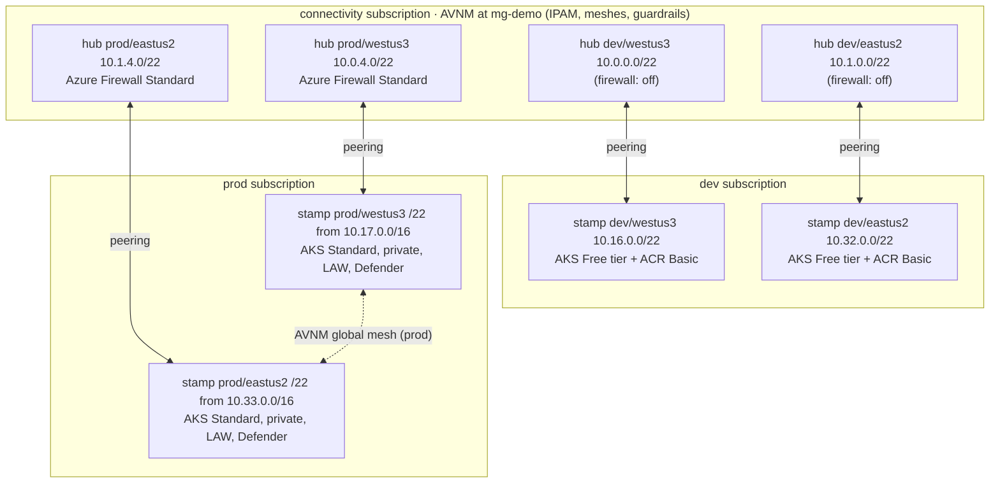

# Architecture

## Topology

Each environment × region pair is a hub-and-spoke deployment: a hub VNet
(optionally hosting an Azure Firewall) in the **connectivity subscription**,
peered with a spoke VNet in the **environment's subscription** that contains
the AKS cluster, its optional ACR, and a subnet reserved for private
endpoints. Above them sits a tenant-level platform: a management-group
hierarchy and one Azure Virtual Network Manager
([subscriptions.md](subscriptions.md)).



All address ranges are globally non-overlapping (see [ipam.md](ipam.md)), so
hubs can later be peered to each other or to on-prem without renumbering.
Each spoke is a uniform /22 *stamp* with a fixed subnet layout; with
`enable_avnm` the /22 is allocated by AVNM IPAM and all stamps of an
environment are meshed directly across regions - see
[network-platform.md](network-platform.md).

## Why not `Azure/terraform-azurerm-avm-ptn-aks-enterprise` directly?

This repo was inspired by that pattern module, but does not consume it. At
v0.1.0 (its only release) the module:

- hardcodes an **Azure Firewall Standard** (~$912/mo), **ACR Premium**, a
  **private cluster with user-defined routing**, and a
  **Standard_D16ds_v5** default node pool (~$500+/mo);
- creates its **own VNet** with no input for an existing subnet;
- exports only the AKS resource — **no VNet ID output** — so a true
  hub-and-spoke peering topology cannot be built around it.

Instead, the same building blocks it uses internally — Azure Verified
Modules — are composed directly, with every expensive feature behind a
toggle:

| Layer | Module | Version |
|---|---|---|
| Hub VNet (+ optional firewall) | `Azure/avm-ptn-hubnetworking/azurerm` | 0.13.2 |
| Spoke VNet + peering | `Azure/avm-res-network-virtualnetwork/azurerm` | 0.19.0 |
| Spoke subnets | `…/avm-res-network-virtualnetwork/azurerm//modules/subnet` | 0.19.0 |
| Network platform (AVNM, IPAM, mesh) | plain `azurerm` resources (no AVM module covers AVNM yet) | - |
| Management groups | plain `azurerm` resources + one `azapi` action | - |
| AKS | `Azure/avm-res-containerservice-managedcluster/azurerm` | 0.6.7 |
| ACR | `Azure/avm-res-containerregistry-registry/azurerm` | 0.5.1 |
| Log Analytics | `Azure/avm-res-operationalinsights-workspace/azurerm` | 0.5.1 |

## Terragrunt layering (how DRY works here)

```
live/
├── root.hcl            backend + provider generation; subscription placement per unit path
├── _envcommon/
│   ├── management-groups.hcl  tenant hierarchy, subscription placement (reads platform.hcl)
│   ├── platform-network.hcl   reads every env.hcl + region.hcl; dependency "management_groups"
│   ├── hub.hcl                module source, inputs assembled from env+region
│   └── aks-spoke.hcl          ... plus dependencies "hub" and "platform_network" with mock_outputs
├── platform/
│   ├── platform.hcl           environments, subscriptions (env vars), regional root pools
│   ├── management-groups/     applied once per tenant
│   └── network/               applied once per tenant (AVNM, pools, meshes, rules)
├── <env>/env.hcl              all feature toggles and sizing for the environment
└── <env>/<region>/
    ├── region.hcl             location + CIDR assignments
    └── <unit>/terragrunt.hcl  two include blocks, nothing else
```

- **Leaf files are identical 8-line stubs.** Adding a region = one folder,
  one `region.hcl` with two CIDRs, two stub files.
- `_envcommon/*.hcl` reads the nearest `env.hcl`/`region.hcl`/`platform.hcl`
  itself via `read_terragrunt_config(find_in_parent_folders(...))`, so
  leaves carry no wiring.
- `root.hcl` picks the subscription per unit from its path (hubs and the
  network platform → connectivity, stamps → the environment's subscription,
  management groups → management) and generates the provider block; the
  IDs come from `TG_SUBSCRIPTION_*` env vars with `ARM_SUBSCRIPTION_ID` as
  the fallback, so a single-subscription setup needs no extra configuration.
- The spoke declares `dependency "hub"` and `dependency "platform_network"`
  with `mock_outputs`, so `init`/`validate`/`plan` work before either exists
  (fresh clones, CI). `platform/network` is an *external* dependency of
  every environment: apply `live/platform` first (or pass
  `--queue-include-external`).
- When `TG_STATE_*` env vars are unset, `root.hcl` falls back from the
  `azurerm` backend to a throwaway local backend, letting the entire graph
  validate offline with zero Azure access.
- Classic includes are used rather than the newer Terragrunt stacks feature -
  deliberately, for readability: this matrix is small and the include pattern
  is what most readers know.

## Cross-stack contract

`modules/hub` outputs (`vnet_id`, `vnet_name`, `resource_group_name`,
`firewall_private_ip`, `location`) and `modules/platform-network` outputs
(`ipam_pool_ids` and `ipam_pool_prefixes` keyed env → region,
`network_group_ids`, `root_pool_ids`, `network_manager_id`) are the only
interfaces the spoke consumes; `modules/management-groups` exposes
`top_management_group_id` to the network platform. The spoke creates
**both** peering directions via the vnet module's `create_reverse_peering`
(full resource IDs, so it works across subscriptions), so adding or
destroying a spoke never touches the hub's state; and the platform never
references a spoke - network group membership is by tag through Azure
Policy - so adding a stamp never touches the platform's state either.

## Hub-to-hub transit (cross-region cluster-to-cluster)

**VNet peering is not transitive.** Peering the two hubs does nothing for
spoke-to-spoke traffic by itself - packets from spoke1 arriving at hub1 are
dropped unless something in the hub *forwards* them. This repo implements the
standard solution: an Azure Firewall in each hub plus user-defined routes.

The data path from a pod in dev/westus3 to a service in dev/eastus2:

```
pod 192.168.x.x (overlay, SNATs to node 10.16.x.x)
  → node subnet UDR: 10.0.0.0/8 → FW1 (10.0.0.4)
  → FW1 subnet UDR: 10.32.0.0/16 → FW2 (10.1.0.4)   [rides hub<->hub global peering]
  → FW2: hub2 is peered with spoke2, system route delivers
  → node/ILB 10.32.x.x
```

The pieces, all toggled by `enable_firewall` in `env.hcl`:

- **Firewall Basic** in each hub (`modules/hub`), with a policy rule
  collection allowing private-to-private transit (Azure Firewall is
  default-deny).
- **Hub↔hub global peering**, declared on exactly one side
  (`live/dev/eastus2/hub/terragrunt.hcl`) with `allow_forwarded_traffic` in
  both directions, since transiting packets carry spoke source addresses.
- **Firewall-subnet routes** (`firewall_route_entries` per hub leaf): each
  firewall forwards the *remote* spoke CIDR to the *remote* firewall.
- **Node-subnet route table** (`modules/aks-spoke`, driven by the hub's
  `firewall_private_ip` output): `10.0.0.0/8 → local firewall`. Azure's
  more-specific system routes keep intra-VNet and spoke↔hub traffic direct,
  and internet egress stays on the cluster load balancer (`outbound_type`
  is untouched).

When `enable_avnm` is on, the spoke's 10/8 route is **not** created: the
AVNM connected-group route carries east-west traffic directly and a UDR
would override it. See [network-platform.md](network-platform.md) for the
side-by-side.

Two conventions worth knowing:

- Firewall private IPs are **deterministic**: Azure assigns the first host
  (.4) of AzureFirewallSubnet, which this repo always carves as the first /26
  of the hub range - so `10.0.0.4` / `10.1.0.4` can be written as constants
  in the hub leaf files instead of creating a circular dependency between the
  two hub states (each would need the other's firewall IP).
- Only the pod/node path is routed through the firewalls. The AKS API servers
  are reached over their public endpoints as before.

## Security posture (and its dev-mode trade-offs)

- Entra ID managed AAD + Azure RBAC for Kubernetes authorization; OIDC
  issuer + workload identity on by default (free).
- Dev: public API server restricted to `TG_AUTHORIZED_IP`; prod: private
  cluster.
- No secrets in the repo: provider auth via `az login`/OIDC env vars, state
  auth via Entra RBAC (no storage keys), kubelet→ACR via managed identity
  role assignment.
- Defender, container insights, and diagnostic settings are off in dev purely
  for cost - flip the toggles in `env.hcl` for anything real.


## DNS

Public: `azure.example.com` with one delegated child zone per
environment, created once from `live/platform/dns`; private:
`svc.<env>.platform.internal` per environment behind `enable_private_dns`.
See [dns.md](dns.md).

## Optional layers

Egress via the hub firewall (per-stamp UDR or AVNM routing), the
approved-pool policy, central private DNS with per-stamp external-dns
identities, DNS Private Resolver, Bastion, API server VNet integration and
additional stamps per region are all toggles that default to off; they are
described in [network-platform.md](network-platform.md) ("Optional layers")
and priced in [costs.md](costs.md). Additional stamps are folders
(`aks-spoke-2`, ...) whose name becomes the `-2` suffix on every resource
and the `stamp-id` tag; they stay excluded from `run --all` until
`enable_extra_stamps = true`.
